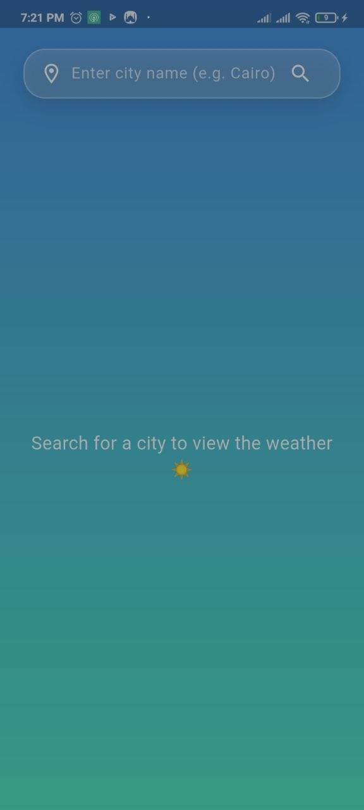
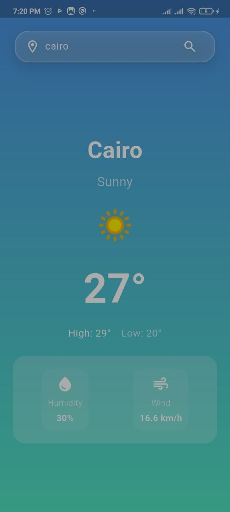
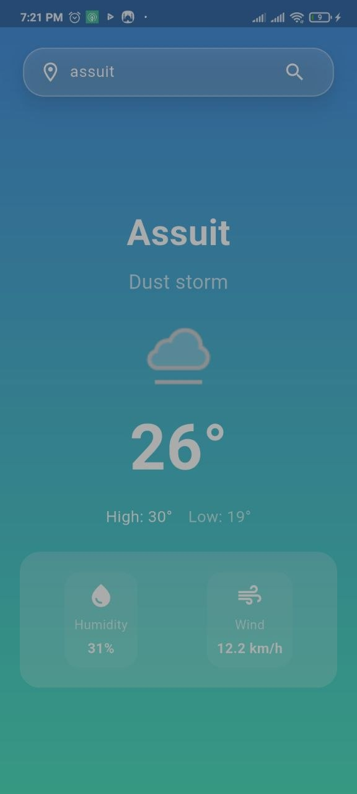

# 🌤️ Flutter Weather App

A weather mobile application built with **Flutter and Dart**, providing real-time weather information through REST API integration. The app features city-based weather searches, dynamic UI updates, and efficient state management using Cubit (Bloc).

## ✨ Features

- Search for weather information by city name.
- Display current temperature and weather conditions.
- Update the interface dynamically based on weather conditions.
- Display weather-related icons.
- Handle API errors and network failures.

## 🛠️ Technologies Used

- **Flutter & Dart** – Cross-platform mobile development.
- **REST API** – Fetching real-time weather data.
- **Cubit (Bloc)** – State management.
- **Dio** – API requests (keep only the package actually used).

## 📸 Screenshots

## 📸 Screenshots

| Home Screen                   | Search Screen                     | Weather Conditions                  |
| ----------------------------- | --------------------------------- | ----------------------------------- |
|  |  |  |

## 🚀 Getting Started

1. Clone the repository:

   ```bash
   git clone https://github.com/Ahmed-M-Khedr/flutter-weather-app.git
   ```

2. Navigate to the project directory:

   ```bash
   cd flutter-weather-app
   ```

3. Install dependencies:

   ```bash
   flutter pub get
   ```

4. Configure the weather API key according to the project's configuration.

5. Run the application:

   ```bash
   flutter run
   ```

## 👨‍💻 Developer

**Ahmed Mohamed Khedr**

- [GitHub](https://github.com/Ahmed-M-Khedr)
- [LinkedIn](https://www.linkedin.com/in/ahmedkhedr172)

## 📌 Project Status

Completed — August 2026.
